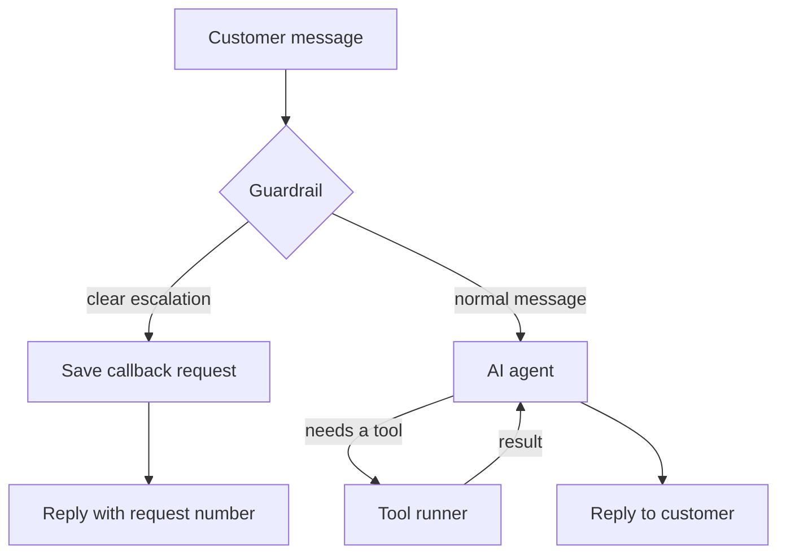

# Customer Support Agent

An agentic RAG customer support assistant for a fictional DTH company.
Customers log in with their registered mobile number, chat in plain language,
and the assistant answers from help documents, reads their account, troubleshoots,
and changes things only after confirmation.

> The company, customers, packs and prices are all fictional. This is a learning project.

## How it works


## What works so far
- A database built from a JSON file (customers, connections, packs, channels, work orders, and more)
- Tools that read and change the data, each with its business rules in code:
  account lookup, work orders, temporary suspension and resume, add and drop packs,
  callback requests, IT tickets, account refresh
- Help documents in `docs/`, split into chunks and searched by meaning (Chroma, stored locally)
- A guardrail that sends clear escalations (manager, legal threats, abuse, refused charges)
  to a callback request, without using the AI
- An agent loop that lets an AI model (through OpenRouter) use the tools, with the
  logged-in customer's ID injected by the code, never chosen by the AI
- The same flow as a LangGraph graph (guardrail node, then agent node)
- Login with a one-time code (demo: shown on screen), and a Streamlit chat screen
- 87 automated tests (`python -m pytest`), using a fake AI so no requests are spent
- Evaluation sets: the guardrail (`python -m evaluation.guardrail_eval`) and 8 full
  conversations with the real AI (`python -m evaluation.conversation_eval`)

## Coming next
- Deploy a public demo
- A second guardrail layer where the AI judges the customer's tone
- More evaluation scenarios, and a short demo video

## How to run
```
python seed.py                         # builds customer_support.db
python -m pytest                       # runs all tests
python -m src.rag.ingest               # builds the document search (first run downloads a small model)
streamlit run ui/app.py                # the chat screen (needs the .env file below)
python chat_cli.py                     # or chat in the terminal
```
Create a `.env` file (never upload it) with:
```
OPENROUTER_API_KEY=your-key
OPENROUTER_MODEL=a-free-model-that-supports-tools
```
`python list_free_models.py` lists free models that support tool calling.

## Design decisions
- **Rules live in code, not in the AI prompt.** The AI can ask a tool to do something, but the tool refuses if a rule is broken.
- **The subscriber ID comes from the login session**, never from the text a customer types or from the AI.
- **No live human handoff.** Angry customers, manager requests, refused charges and legal threats become a callback request, and a supervisor calls back within 15 to 30 minutes.
- **Minimum recharge is 200 rupees**, and a recharge is never less than the missing amount.
- **Tests use a fake AI**, so they are fast, free and repeatable. The real AI is checked separately by the conversation evaluation.
- **Local vector search.** Chroma runs on the computer and needs no account. `chroma_db/` is generated by `python -m src.rag.ingest` and is not uploaded.
- **The one-time code is shown on screen only in this demo.** A real app would send it by SMS.
- Every tool returns a clear result (`ok` plus a reason), so the assistant can explain refusals politely.